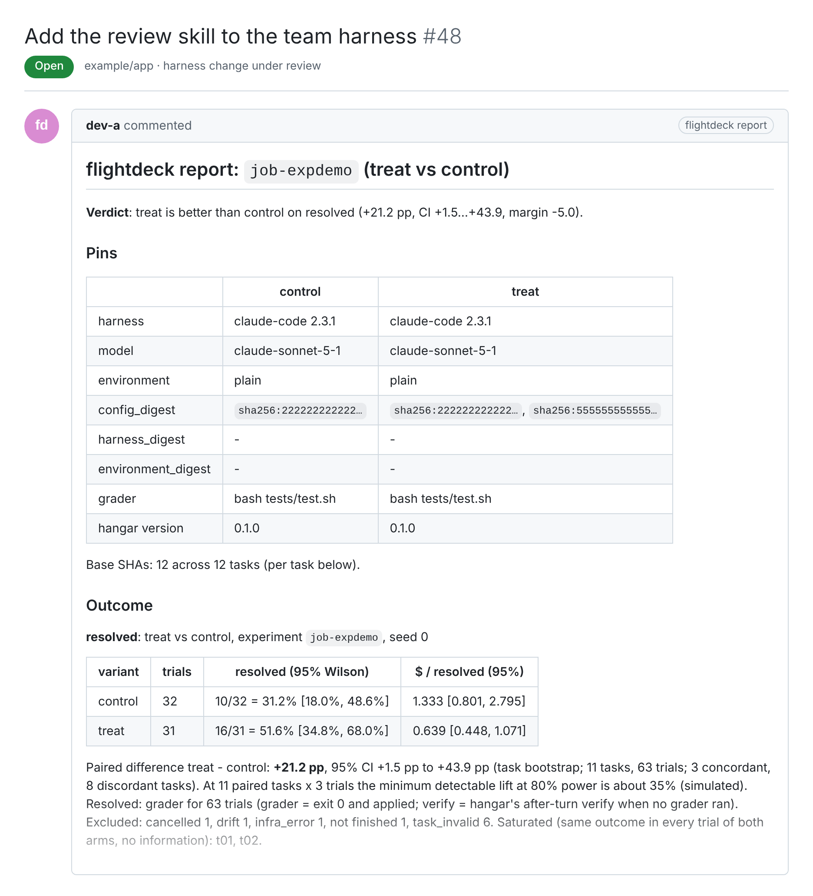
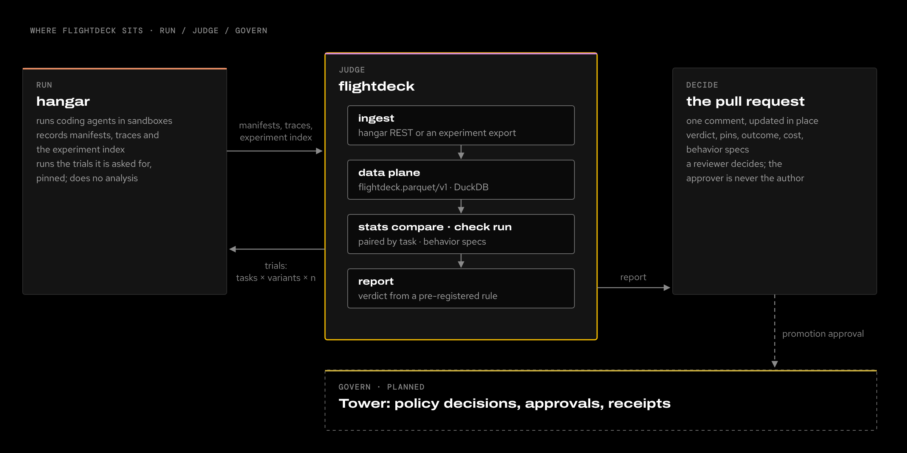

<picture>
  <source media="(prefers-color-scheme: dark)" srcset="docs/assets/brand/banner-dark.svg">
  
</picture>

# flightdeck

**Did that harness change actually help our coding agents, or did we just get lucky on a few runs?** Flightdeck answers
that from the runs [hangar](https://github.com/Sean-Koval/hangar) already records: paired statistics, behavior specs
and a verdict posted on the pull request where the change is reviewed.

Docs site: <https://sean-koval.github.io/flightdeck/> · Part of the [agent factory](https://sean-koval.github.io/agent-factory/)
(Run / **Judge** / Govern).

## See it work

`ingest → check run → stats compare → report` on the synthetic fixture experiment (12 tasks × 2 variants × 3 trials):


The report, posted as one pull-request comment that is updated in place (rendered from the same run):



<details><summary><code>stats compare</code> on its own</summary>


</details>

## Where it sits

<picture>
  <source media="(prefers-color-scheme: light)" srcset="docs/assets/suite-light.png">
  
</picture>

Flightdeck holds no sandbox code and no credentials ([ADR-0001](docs/decisions/0001-boundary-with-hangar.md)): it
reads hangar's versioned interfaces and asks hangar to run the trials it plans.

## Use cases

- **Bump the CLI lock with evidence.** A harness maintainer opens the canary PR that moves claude-code to a new
  version, runs the regression suite on both locks with `flightdeck experiment run`, and gets a comment on the PR such as
  *non-inferior on resolved, −0.8 pp, CI −4.1…+2.5* or *No decision: underpowered*, with the cost per resolved task
  beside it.
- **Decide whether a workflow plugin pays for itself.** A team lead A/Bs the ai-dlc plugin on and off across 30 tasks.
  Trials are paired by task, so the answer needs a fraction of the runs an unpaired comparison would, and the verdict
  follows a `decision.yaml` committed before the first trial, so nobody moves the goalposts afterwards.
- **Catch a behavior regression nobody tested for.** A platform engineer writes "never push to main" and "run trusted
  tests before committing" as behavior specs. The nightly `flightdeck check run` scores every turn and opens an issue
  when a violation rate jumps, naming the harness digest that changed that day.

## Quickstart

Needs [uv](https://docs.astral.sh/uv/) and git. Five commands, on the fixture experiment (no hangar, no team data):

```sh
git clone https://github.com/Sean-Koval/flightdeck && cd flightdeck
uv run python scripts/fixture_export.py demo/export        # what `hangar experiment export <id> -o DIR` writes
uv run flightdeck ingest export demo/export --out demo/plane
uv run flightdeck stats compare job-expdemo --data demo/plane
uv run flightdeck report experiment job-expdemo --data demo/plane --decision demo/export/decision.yaml
```

Against a real hangar, ingest with `HANGAR_TOKEN=... flightdeck ingest experiment <id> --hangar https://<your hangar>`
and post with `--post owner/repo#n`. [Getting started](docs/getting-started.md) has the rest.

## Features

| Feature | What you get | Docs |
| --- | --- | --- |
| Ingest | Hangar REST or `hangar experiment export` into `flightdeck.parquet/v1` (runs, spans, events, manifests, grades, test cases), idempotent; `flightdeck query` over DuckDB | [Data plane](docs/data-plane.md) |
| Paired statistics | Task bootstrap, Wilson, pass@k and pass^k, $ per resolved task, a power estimate; exclusions (`infra_error` from hangar, cancelled, drift) always printed | [Statistics](docs/statistics.md) |
| Behavior specs | YAML predicates over `hangar.trace/v1` that count only trusted test runs; ADR `checks:`; nightly runner with change-point alerts | [Behavior specs](docs/behavior-specs.md) |
| Reports | Markdown with a pre-registered verdict, pins, outcome, process, cost and spec pass rates, posted as one PR comment | [Reports](docs/reports.md) |
| Experiments | Suites of Harbor-compatible tasks submitted to hangar with concrete model pins and a cost gate | [Running experiments](docs/runners.md), [Tasks](docs/tasks.md) |
| Small by design | A counted line budget for the analysis code, enforced in CI; every raise is a measured ADR | [ADR-0005](docs/decisions/0005-post-v0-budget.md) |

Vocabulary (run, turn, trial, check vs grader) is in [Concepts](docs/concepts.md).

## Development

```sh
uv sync
uv run ruff check src tests scripts docs/assets && uv run pyright && uv run pytest -q
python scripts/loc_budget.py
uv run --group assets python docs/assets/build.py   # re-render the front-page assets (CI checks they are current)
```

See [CONTRIBUTING.md](CONTRIBUTING.md). Team data never goes in this repository
([ADR-0002](docs/decisions/0002-public-code-private-data.md)).

## License

Apache-2.0. See [LICENSE](LICENSE) and [NOTICE](NOTICE).
