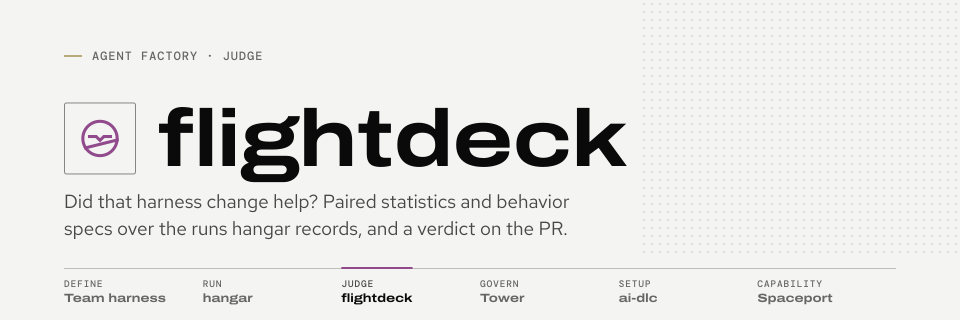
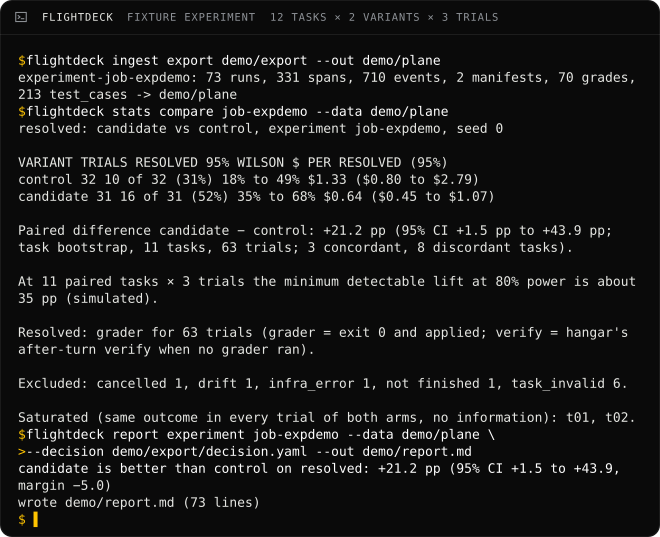

<picture>
  <source media="(prefers-color-scheme: dark)" srcset="docs/assets/brand/banner-dark.svg">
  
</picture>

# flightdeck

**Did that harness change actually help our coding agents, or did we just get lucky on a few runs?** Flightdeck
answers that from the runs [hangar](https://github.com/Sean-Koval/hangar) already records, as a verdict posted on the
pull request where the change is reviewed.

> **The verdict** is one of five words: *better*, *non-inferior*, *worse*, *No decision* or *No verdict*. It says how
> the candidate arm did against the control arm on one metric, with the paired difference and its 95% interval:
> *candidate is better than control on resolved: +21.2 pp (95% CI +1.5 to +43.9, margin −5.0)*. The rule that picks
> the word is committed before the first trial, so nobody moves the goalposts.



## Six commands

Needs [uv](https://docs.astral.sh/uv/) and git. They run on the synthetic fixture experiment: no hangar, no team data.

```sh
git clone https://github.com/Sean-Koval/flightdeck && cd flightdeck
uv run python scripts/fixture_export.py demo/export
uv run flightdeck ingest export demo/export --out demo/plane
uv run flightdeck check run --data demo/plane --date 2025-10-16 \
    --specs specs/examples/team-default.yaml
uv run flightdeck stats compare job-expdemo --data demo/plane
uv run flightdeck report experiment job-expdemo --data demo/plane \
    --decision demo/export/decision.yaml
```

The last line printed is the verdict above. Against a real hangar, ingest with
`HANGAR_TOKEN=... flightdeck ingest experiment <id> --hangar https://<your hangar>` and post with `--post owner/repo#n`.

## Read on

- [Docs](https://sean-koval.github.io/flightdeck/): what flightdeck is and isn't, where it sits in the
  [agent factory](https://sean-koval.github.io/agent-factory/), and what is shipped.
- [Getting started](https://sean-koval.github.io/flightdeck/getting-started/): the six commands explained, then a
  real hangar.
- [Reports](https://sean-koval.github.io/flightdeck/reports/): the pre-registered rule and the report's anatomy.

Contributing: [CONTRIBUTING.md](CONTRIBUTING.md). Team data never goes in this repository
([ADR-0002](docs/decisions/0002-public-code-private-data.md)).

## License

Apache-2.0. See [LICENSE](LICENSE) and [NOTICE](NOTICE).
