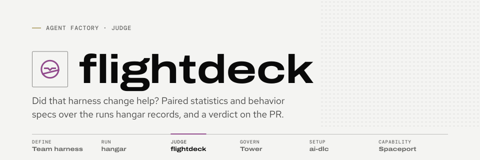
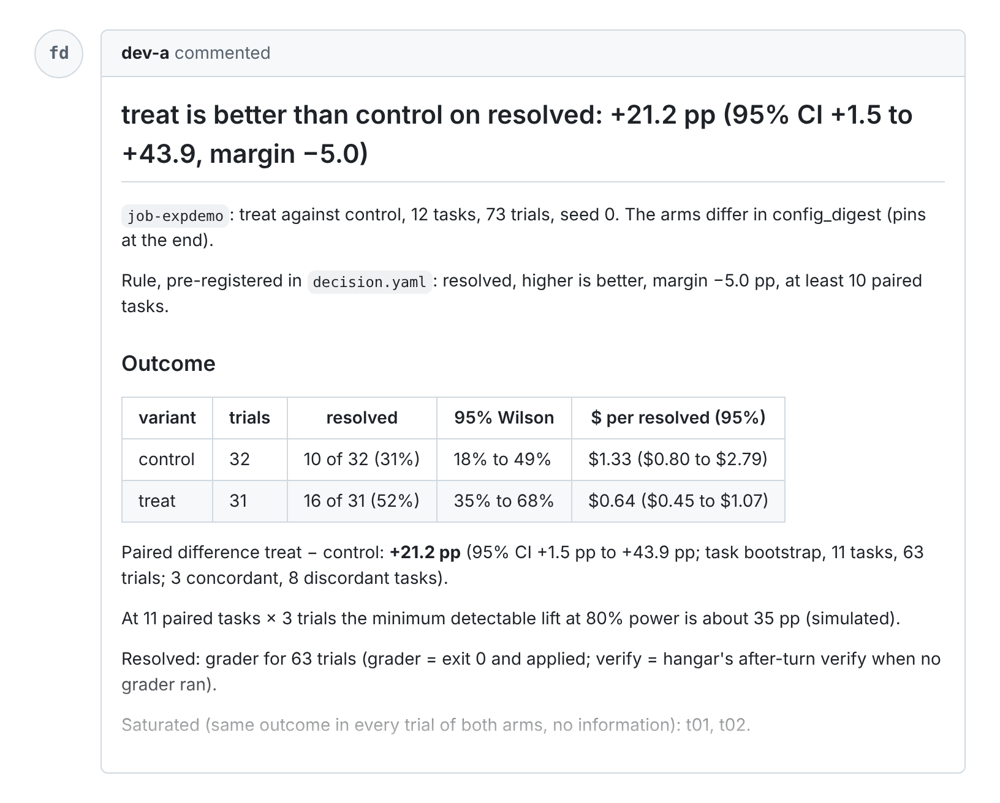
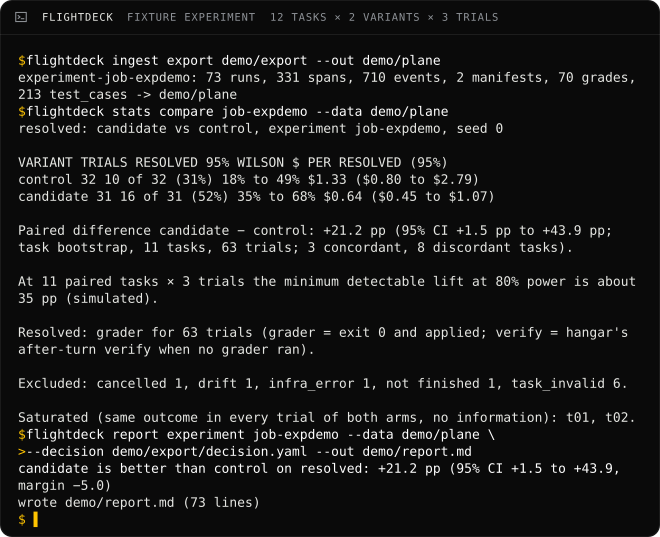

<picture>
  <source media="(prefers-color-scheme: dark)" srcset="docs/assets/brand/banner-dark.svg">
  
</picture>

# flightdeck

**Did that harness change actually help the coding agents, or was it luck on a few runs?** flightdeck answers
that from the runs [hangar](https://github.com/Sean-Koval/hangar) already records, as a verdict posted on the
pull request where the change is reviewed.

<picture>
  <source media="(max-width: 600px) and (prefers-color-scheme: dark)" srcset="docs/assets/report-comment-phone-dark.png" width="358" height="368">
  <source media="(max-width: 600px)" srcset="docs/assets/report-comment-phone-light.png" width="358" height="368">
  <source media="(prefers-color-scheme: dark)" srcset="docs/assets/report-comment-dark.png">
  
</picture>

> **The verdict** is the comment's headline, and one of five words: "better", "non-inferior", "worse", "No decision"
> or "No verdict". It compares the candidate arm with the control arm on one metric, paired by task. The rule that
> picks the word is committed before the first trial, so nobody moves the goalposts.

The same run in a terminal, on the synthetic fixture experiment:

<picture>
  <source media="(max-width: 600px)" srcset="docs/assets/demo-phone.svg" width="379" height="401">
  
</picture>

## Six commands

Needs [uv](https://docs.astral.sh/uv/) and git. They run on the synthetic fixture experiment: no hangar, no team data.

```sh
git clone https://github.com/Sean-Koval/flightdeck && cd flightdeck
uv run python scripts/fixture_export.py demo/export
uv run flightdeck ingest export demo/export --out demo/plane
uv run flightdeck check run --data demo/plane --date 2025-10-16 \
    --specs specs/examples/team-default.yaml
uv run flightdeck stats compare job-expdemo --data demo/plane
uv run flightdeck report experiment job-expdemo --data demo/plane \
    --decision demo/export/decision.yaml
```

The last line printed is the verdict above. Against a real hangar, ingest with
`HANGAR_TOKEN=... flightdeck ingest experiment <id> --hangar https://<your hangar>` and post with `--post owner/repo#n`.

## Read next

| You want to | Read |
| --- | --- |
| Run it yourself | [Getting started](https://sean-koval.github.io/flightdeck/getting-started/): the six commands explained, then a real hangar |
| Read a report | [Reports](https://sean-koval.github.io/flightdeck/reports/): the comment's anatomy and the pre-registered rule |
| Know what it can detect | [Statistics](https://sean-koval.github.io/flightdeck/statistics/): paired by task, with the power table |
| See what is shipped | [What's shipped](https://sean-koval.github.io/flightdeck/status/), and where flightdeck sits in the [agent factory](https://sean-koval.github.io/agent-factory/) |

Contributing: [CONTRIBUTING.md](CONTRIBUTING.md). Team data never goes in this repository
([ADR-0002](docs/decisions/0002-public-code-private-data.md)).

## License

Apache-2.0. See [LICENSE](LICENSE) and [NOTICE](NOTICE).
