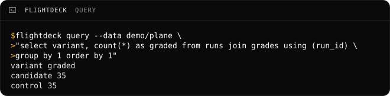

# Data plane

flightdeck reads hangar's runs from Parquet files, never from a live hangar, so reports work while hangar's sandbox
pools are off. The contract is `flightdeck.parquet/v1`.

<div class="af-figure" markdown>
--8<-- "docs/assets/flow-data-plane.svg"
<figcaption>Two ways in (the nightly compactor, ingest on demand), one set of tables out</figcaption>
</div>

hangar writes each finished run once to a GCS outbox (`hangar.run/v1`, hangar `docs/api/outbox.md`). The nightly
[compactor](#compactor) turns it into these tables, and DuckDB queries them (ADR-0001 point 3). For one experiment's
results right away, the same flatteners run over `hangar experiment export` and REST exports ([ingest](#ingest)).

Code: `src/flightdeck/dataplane/`. `schema.py` holds the tables, `flatten.py` the flatteners, `duck.py` the views,
`compact.py` the compactor and `github.py` the `prs` table.

## Layout and versioning

```
<root>/<table>/dt=YYYY-MM-DD/part-*.parquet      zstd; dt is in the path (hive partitioning), not the file
```

`<root>` is `FLIGHTDECK_DATA_URI`: a local directory or a private `gs://` bucket (ADR-0002). Each file's schema
metadata carries `flightdeck.schema = flightdeck.parquet/v1` and its table name.

Within v1, columns are only added; removing or renaming one is v2. Rows are wide and denormalized: resource
attributes (job, session, environment, person) are copied onto every span row.

Every row has `run_id`, `source` and `dt`. `source` is `job`, `session`, `experiment`, `shadow`, or `local` for the
[local backend](local.md).

## Tables

| Table | Grain | From | Notes |
| --- | --- | --- | --- |
| `runs` | one turn (`run_id` = `hangar.run.id`) or one trial (`run_id` = `<experiment>/<task>/<variant>/<n>`) | trace `turn` span + its job's events; experiment `trials[]` | `verify_passed` from the job's `verify` event (`phase = after_turn`) or the trial's `verify.passed`; `diff_files` from `hangar.diff.files`, since shell writes aren't `file.change` events; `merged`/`merged_by` from `pr.merge`; `truncated` from `hangar.export.truncated` |
| `spans` | one OTLP span | trace | Columns for the taxonomy (`kind` = `hangar.kind`, `tool_kind`, `shell_ops`, `seq`, `seq_end`, `file_repo_path`, `mcp_*`, `approval_*`); everything else in `attrs` JSON. Job/session root spans take the job or session id as `run_id` |
| `events` | one span event, except test results | trace | `steer`/`interrupt` events carry `seq` and, in `attrs`, `hangar.steer.class` since hangar#162; older ones have no seq, so their order is by time only |
| `manifests` | one `hangar.manifest/v1`, deduplicated by `digest` | manifest | `skills_effective` as `name@digest`; `json` keeps the whole manifest |
| `grades` | one grader result for a trial | experiment `trials[].grade` | `data` is the JSON the grader wrote to `$HANGAR_GRADE_OUT` |
| `test_cases` | one `test.run` (its `case_name` is null) or one `test.case` | trace `test.run`/`test.case` events; outbox `tests.json` | `trusted` is false for the agent's own in-turn runs; specs that need proof of testing use `trusted and total > 0` |
| `job_events` | one `hangar.job_event/v1` (`run_id` = job id) | outbox `v1/jobs/{date}/{job_id}/events/` | `kind` (`pr.open`, `review.first`, `pr.merge`, `pr.close`, `abandon`, ...); `reason`, `by` and `green_to_merge_seconds` lifted from `data`, which keeps the rest |
| `prs` | one closed GitHub pull request on the team's repos (`run_id` null, `source` = `github`) | GitHub REST, `flightdeck ingest github` | `reverts` is the number of the PR it reverts; for [agent share and reverts](metrics.md#where-the-data-comes-from) |

### What the outbox adds

From the outbox, `runs` also carries `run.json`'s `outcome_class`, `infra_reason`, `job_source`, `job_turn`,
`job_state`, `steers` (`steers.n`) and `questions`. Two flags come with them: `untrusted` (the job's task text came
from outside the trusted list) and `tainted` (the turn read untrusted content). Promotion evidence leaves out runs
with either flag set.

Tapes stay objects under hangar's `v1/tapes/`; they are not compacted.

### What flightdeck writes itself

On collecting its trials, flightdeck stamps `runs.task_digest`, the task directory's digest ([Tasks](tasks.md#digests)).
It also stamps `runs.variant_digest`: the variant as planned, its hangar overlay and environment. They key the [trial cache](cache.md).

`trial_reuse` is flightdeck's too: one row per trial the cache reused for a run set. `run_id` is the reused trial's,
`experiment_id` the run set's, with `age_days`.

`judge_labels` holds one judge label per run, with the rubric version and digest, the judge model, the rationale's
digest and the rubric's calibration status ([Judges](judges.md)).

`spec_results` holds one row per spec or ADR check and unit (a turn, job or session id in `run_id`). Its columns:
`spec_id`, `spec_source` (`spec` or `adr:<repo>/<adr>`), `scope`, `result` (`pass`, `fail`, `not_applicable`,
`unknown`), `repo`, `harness_digest` and `knowledge_snapshot` ([Behavior specs](behavior-specs.md)).

### Nullable until hangar emits them

`knowledge_snapshot` and `grader_digest` stay null until hangar emits them. Traces fill `harness_digest`,
`environment_digest`, `job_state`, `job_reason` and `cache_write_tokens`; where `run.json` has one too, it wins.

`runs.outcome_class` is `agent`, `infra_error`, `cancelled` or `human`, and null for records from before hangar#166.
It and `infra_reason` come from the trial, or from the turn span's `hangar.outcome.class` and
`hangar.outcome.infra_reason`. `excluded` and `attempt` come from the trial.

## Decoding

OTLP/JSON per opentelemetry-proto 1.11.1: `intValue` is a decimal string, lists are `arrayValue.values`,
`kvlistValue` becomes a dict. Unknown attributes are kept in `attrs`, never an error, since hangar adds fields within
v1. A different `hangar.trace.schema`, manifest or experiment schema is refused.

hangar redacts every export. The flatteners also mask anything that still looks like a credential (private keys,
GitHub, Anthropic/OpenAI, AWS and Slack tokens) as `***`. They clip event text to 2,000 characters.

## Ingest

`flightdeck ingest` pulls one experiment, job or session from hangar now, or reads an export. It is idempotent and
validated against hangar's schemas. [Ingest](ingest.md) has the commands, the token scopes and the rules.

## Compactor

`flightdeck compact` turns hangar's outbox into these tables every night, as a Cloud Run job.
[The compactor](compactor.md) has the partitions, late arrivals, its identity and the runbook.

## `flightdeck.weekly/v1`

[`flightdeck metrics weekly`](metrics.md) writes `<reports>/weekly/<week>.json`, `<week>.md` and `latest.json`, with
`FLIGHTDECK_REPORTS_URI` = `gs://<team>-flightdeck/reports`. hangar's standup line and digest read `latest.json` and
never recompute.

JSON Schema:
[`src/flightdeck/metrics/weekly.schema.json`](https://github.com/Sean-Koval/flightdeck/blob/main/src/flightdeck/metrics/weekly.schema.json),
additive within v1.

| Field | Meaning |
| --- | --- |
| `schema`, `week`, `start`, `end` | `flightdeck.weekly/v1`; the ISO week (`2026-W45`), its Monday and the next Monday (UTC) |
| `scope` | `{person, repo}`; both null in the shared files |
| `metrics` | one object per metric in [metrics.md](metrics.md): rates as `{k, n, rate, ci95}` (Wilson 95%; null when `n` is 0), `review_wait` and `green_to_merge` as `{n, p50_h, p90_h}`, the rest as `{n, value}`; `abandon.by_reason` maps reason to count |
| `trailing` | the four weeks ending with `week`, oldest first, each `{week, metrics}` |

## Querying

<figure class="af-figure fd-term" markdown>
{ width=660 }
<figcaption>SQL over the fixture's data plane: 35 graded runs in each arm</figcaption>
</figure>

```sh
flightdeck query "select variant, count(*) from runs join grades using (run_id) group by 1" --data ./plane
```

`duck.connect(uri)` registers one view per table (`read_parquet(..., hive_partitioning=true, union_by_name=true)`).
A table without files is an empty view of its schema. Timestamps are shown in UTC.

For `gs://`, install the `gcs` extra (below, or `pip install 'flightdeck[gcs]'`). DuckDB then reads
through gcsfs with your Google application-default credentials (`gcloud auth application-default login`). Without it,
DuckDB's `httpfs` is loaded and the caller supplies a DuckDB GCS secret (HMAC keys). flightdeck holds no credentials
either way.

```sh
uv sync --extra gcs
flightdeck query "select count(*) from runs" --data gs://<private-bucket>/plane
```

Truncated exports (`hangar.export.truncated`, hangar's 20,000-item cap) set `runs.truncated`. Process metrics (tool
calls, cost, wall time) leave those trials out by default and say so; outcome metrics keep them.

## Size

About 1.5 MiB of OTLP per run gives roughly 1.5 GiB a month as zstd Parquet at the team's volume. DuckDB over Parquet
is enough until about 1 TB.

## Next

- [Contracts](contracts.md): the column tables of `flightdeck.parquet/v1`, generated from the code.
- [Running experiments](runners.md#collecting): how `collect` fills the plane.
- [Behavior specs](behavior-specs.md): the SQL evaluator over these tables.
- [Weekly metrics](metrics.md): the scorecard computed from them.
