---
hide:
  - navigation
  - toc
---

Agent factory · Judge

# Did that harness change actually help?

flightdeck answers that from the runs hangar already records: paired statistics, behavior specs and a <a href="#the-verdict">verdict</a> posted on the pull request where the change is reviewed.

[Get started](getting-started.md){ .md-button .md-button--primary } [Suite overview](https://sean-koval.github.io/agent-factory/){ .md-button }

<figure class="af-hero__visual">
<picture>
<source media="(max-width: 600px)" srcset="assets/demo-phone.svg" width="379" height="401">

</picture>
<figcaption>The fixture experiment in a terminal: compare the arms, write the report, read the verdict. Watch it end as a pull-request comment (18 s): <a href="assets/clip.mp4">Night</a>, <a href="assets/clip-light.mp4">Day</a>.</figcaption>
</figure>

## The answer, on the pull request

<figure class="af-figure fd-native" style="--fd-native: 816px">
<picture>
<source media="(max-width: 600px)" srcset="assets/report-comment-phone-dark.png" width="358" height="368">

</picture>
<picture>
<source media="(max-width: 600px)" srcset="assets/report-comment-phone-light.png" width="358" height="368">

</picture>
<figcaption>The verdict as a pull-request comment: the headline, then experiment FDK-EXP-0531 and its rule</figcaption>
</figure>

One comment, updated in place. This one is the synthetic fixture experiment: 12 tasks × 2 variants × 3 trials. The
terminal above is the run that wrote it, and [Getting started](getting-started.md) repeats it in six commands.

## Five words, one rule { #the-verdict }

<figure class="af-figure" markdown>
--8<-- "docs/assets/verdict-rule.svg"
<figcaption>The verdict is one of five words; where the paired difference's 95% interval sits picks it</figcaption>
</figure>

The rule lives in `decision.yaml`: metric, direction, margin, minimum tasks. It is committed before the first trial
finishes, so nobody moves the goalposts. [Reports](reports.md#pre-registration) has the rule in full, and
[Concepts](concepts.md) has the words.

## What it is, and isn't

  
<small>Is</small><b>The judge</b>It reads what hangar recorded and says whether a change helped.

  
<small>Isn't</small><b>A runner or a dashboard</b>Nor a leaderboard, nor a credential holder: it has no sandbox code.

  
<small>Sees</small><b>About 15 points</b>At 500 trials a month. Smaller changes show through cost, tool calls and behavior specs.

[What flightdeck can tell you](statistics.md#what-flightdeck-can-tell-you) has the numbers behind "about 15 points".

## Where it sits

<figure class="af-figure" markdown>
--8<-- "docs/assets/suite.svg"
<figcaption>hangar runs the trials, flightdeck judges them, the pull request decides; Tower governs risky actions</figcaption>
</figure>

flightdeck holds no sandbox code and no credentials ([ADR-0001](decisions/0001-boundary-with-hangar.md)). It reads
hangar's versioned interfaces and asks hangar to run the trials it plans.

## Three decisions it settles

  
<small>A version bump</small><b>Bump the CLI lock with evidence</b>Run the regression suite on the old lock and the new one. The canary PR gets one comment: the verdict, and each lock's cost per resolved task.

  
<small>A plugin</small><b>Does the workflow plugin pay for itself?</b>A/B it on and off across 30 tasks. Pairing by task needs far fewer runs than an unpaired comparison.

  
<small>A regression</small><b>Catch what nobody tested for</b>Write "never push to main" as a behavior spec. Nightly, check run opens an issue when the violation rate jumps.

## Start from your question

  <a class="af-tool" href="getting-started/"><small>Try it</small><b>Can I see it run?</b>Six commands on the fixture, no hangar and no team data.</a>
  <a class="af-tool" href="reports/"><small>Read</small><b>What does a report say?</b>The comment's seven parts and the pre-registered rule.</a>
  <a class="af-tool" href="statistics/"><small>Plan</small><b>How big a change can it see?</b>Paired by task, with the power table for this team's scale.</a>
  <a class="af-tool" href="tasks/"><small>Build</small><b>How do I write a task?</b>An instruction, an environment and hidden tests, in Harbor's layout.</a>
  <a class="af-tool" href="runners/"><small>Run</small><b>How do trials get run?</b>A suite becomes pinned trials, a cost gate, then hangar.</a>
  <a class="af-tool" href="behavior-specs/"><small>Check</small><b>How did the agent work?</b>Predicates over traces: tests before the commit, no push to main.</a>
  <a class="af-tool" href="holdouts/"><small>Promote</small><b>Is this number honest?</b>Sealed tasks, written blind and scored once.</a>
  <a class="af-tool" href="cli/"><small>Look up</small><b>Which command, which flag?</b>Every command and option, generated from the code.</a>

New to the vocabulary? [Concepts](concepts.md) defines each word once. [What's shipped](status.md) says what runs
today.
