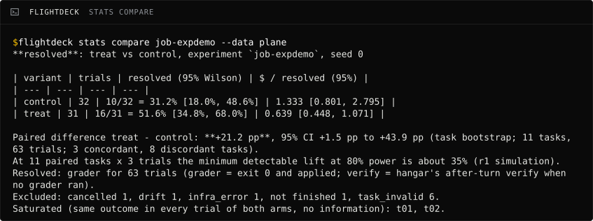

---
hide:
  - navigation
  - toc
---

<div class="af-hero af-hero--visual" markdown>
<div markdown>
<span class="af-eyebrow">Agent factory · Judge plane</span>

# Did that harness change actually help?

<p class="af-lede">Flightdeck answers that from the runs hangar already records: paired statistics, behavior specs and a <a href="#the-verdict">verdict</a> posted on the pull request where the change is reviewed.</p>

[Get started](getting-started.md){ .md-button .md-button--primary } [Suite overview](https://sean-koval.github.io/agent-factory/){ .md-button }
</div>
<figure class="af-hero__visual">

<figcaption>ingest, stats compare, report on the fixture experiment, recorded by docs/assets/build.py</figcaption>
</figure>
</div>

<div id="the-verdict" markdown>
!!! verdict "The verdict"
    One of five words: *better*, *non-inferior*, *worse*, *No decision* or *No verdict*. It says how the treatment
    arm did against the control arm on one metric, with the paired difference and its 95% interval beside it:
    *treat is better than control on resolved: +21.2 pp (95% CI +1.5 to +43.9, margin −5.0)*. The rule that picks the word
    (`decision.yaml`: metric, direction, margin, minimum tasks) is committed before the first trial, so nobody moves
    the goalposts. [Concepts](concepts.md) has the words; [Reports](reports.md#pre-registration) has the rule.
</div>

**Is:** the Judge. It reads hangar's outbox (GCS → Parquet → DuckDB), or an experiment, job or session over
REST, plans the trials, owns the sampling (which tasks, how many trials, when to stop) and posts a verdict where the change is
reviewed. **Isn't:** a runner (beyond a local Docker runner for fixtures and CI), a dashboard, a leaderboard or a
credential holder. **What it can see:** at about 500 trials a month, outcome changes of about 15 points or more (the
share of tasks resolved going from 40% to 55%). Smaller changes are judged by process metrics (tool calls, cost, wall
time), behavior specs and, later, trace-mined micro-evals ([#33](https://github.com/Sean-Koval/flightdeck/issues/33)). See
[what flightdeck can tell you](statistics.md#what-flightdeck-can-tell-you).

## See it work

The verdict, posted as one pull-request comment that is updated in place. This one comes from the synthetic fixture
experiment (12 tasks × 2 variants × 3 trials):

<figure class="af-figure" markdown>
{ width=816 height=656 }
{ width=816 height=656 }
<figcaption>The top of the report on the pull request, from the fixture experiment</figcaption>
</figure>

The run that produced it is the recording above, `ingest → stats compare → report` (`check run`, which feeds the
Behavior specs section, is in the quickstart below).

<details><summary><code>stats compare</code> on its own</summary>



</details>

## Where it sits

<div class="af-figure" markdown>
--8<-- "docs/assets/suite.svg"
</div>

Flightdeck holds no sandbox code and no credentials ([ADR-0001](decisions/0001-boundary-with-hangar.md)): it
reads hangar's versioned interfaces and asks hangar to run the trials it plans.

## Use cases

- **Bump the CLI lock with evidence.** A harness maintainer opens the canary PR that moves claude-code to a new
  version, runs the regression suite on the old lock and the new one with `flightdeck experiment run`, and gets one
  comment on the PR with the pre-registered verdict and the cost per resolved task of each. At 50 tasks × 3 trials, a
  bump that changes nothing typically reads *No decision: the interval on resolved spans the margin, −0.7 pp (95% CI
  −10.0 to +8.7, margin −5.0)*: 300 trials can't prove a 5-point margin. A regression of 20 points comes out *worse*
  about 4 times in 5. Today: both arms run the CLI version hangar's lock pins (`harness@version`), so variants can
  differ in model, skills, instructions and approvals but not in CLI version; lock against lock once the regression
  suite ([#12](https://github.com/Sean-Koval/flightdeck/issues/12)) and `harness_lock` variants ([hangar#135](https://github.com/Sean-Koval/hangar/issues/135)) land in flightdeck.
- **Decide whether a workflow plugin pays for itself.** A team lead A/Bs the ai-dlc plugin on and off across 30 tasks.
  Trials are paired by task, so the answer needs a fraction of the runs an unpaired comparison would (at 30 tasks it
  can see a change of about 20 points), and the verdict follows a `decision.yaml` committed before the first trial, so
  nobody moves the goalposts afterwards.
- **Catch a behavior regression nobody tested for.** A platform engineer writes "never push to main" and "run trusted
  tests before committing" as behavior specs. Scheduled nightly, `flightdeck check run` scores every turn and opens an
  issue when a violation rate jumps, naming the harness digest that changed that day (the schedule lives in the
  team's private data repository; [#15](https://github.com/Sean-Koval/flightdeck/issues/15)).

## Quickstart

Needs [uv](https://docs.astral.sh/uv/) and git. Six commands, on the fixture experiment (no hangar, no team data):

```sh
git clone https://github.com/Sean-Koval/flightdeck && cd flightdeck
uv run python scripts/fixture_export.py demo/export
uv run flightdeck ingest export demo/export --out demo/plane
uv run flightdeck check run --data demo/plane --date 2025-10-16 \
    --specs specs/examples/team-default.yaml
uv run flightdeck stats compare job-expdemo --data demo/plane
uv run flightdeck report experiment job-expdemo --data demo/plane \
    --decision demo/export/decision.yaml
```

The first `uv run` installs the dependencies; after that the six take a few seconds. `scripts/fixture_export.py`
writes what `hangar experiment export <id> -o DIR` writes. Expect, among the output:

```text
experiment-job-expdemo: 73 runs, 331 spans, 710 events, 2 manifests, 70 grades,
  213 test_cases -> demo/plane
SPEC                       APPLIED  PASSED  FAILED  UNKNOWN
never-push-main                 72      72       0        1
5 specs over 73 units: 0 failed, 5 unknown
Paired difference treat − control: +21.2 pp (95% CI +1.5 pp to +43.9 pp;
  task bootstrap, 11 tasks, 63 trials; 3 concordant, 8 discordant tasks).
treat is better than control on resolved: +21.2 pp (95% CI +1.5 to +43.9,
  margin −5.0)
```

The last line is the verdict, and the report's headline. The fixture is built with a large effect so that 11 tasks
can show it; the report also gets a Behavior specs section from `check run`. `report experiment --out demo/report.md`
writes the markdown and prints the verdict.

Against a real hangar, ingest with `HANGAR_TOKEN=... flightdeck ingest experiment <id> --hangar https://<your hangar>`
and post with `--post owner/repo#n`. [Getting started](getting-started.md) has the rest.

## Features

| Feature | What you get | Status | Docs |
| --- | --- | --- | --- |
| Ingest | Hangar REST or `hangar experiment export` into `flightdeck.parquet/v1` (runs, spans, events, manifests, grades, test cases), idempotent; `flightdeck query` over DuckDB | Shipped ([#7](https://github.com/Sean-Koval/flightdeck/issues/7)) | [Data plane](data-plane.md) |
| Compactor | Hangar's GCS outbox into the Parquet data plane, nightly on Cloud Run, while the sandbox pools are off | Shipped ([#5](https://github.com/Sean-Koval/flightdeck/issues/5)); needs hangar's outbox turned on (`HANGAR_OUTBOX_URL`, off by default) | [Data plane](data-plane.md#compactor) |
| Paired statistics | Task bootstrap, Wilson, pass@k and pass^k, $ per resolved task, a power estimate; exclusions (`infra_error` from hangar, cancelled, drift) always printed | Shipped ([#8](https://github.com/Sean-Koval/flightdeck/issues/8)) | [Statistics](statistics.md) |
| Behavior specs | YAML predicates over `hangar.trace/v1` that count only trusted test runs | Shipped ([#14](https://github.com/Sean-Koval/flightdeck/issues/14)) | [Behavior specs](behavior-specs.md) |
| Nightly checks | `check run` over a day of the data plane, ADR `checks:`, change-point alerts | Code merged; [#15](https://github.com/Sean-Koval/flightdeck/issues/15) open until it is scheduled with a real team ADR | [Behavior specs](behavior-specs.md#adr-checks-and-the-nightly-runner) |
| Reports | Markdown with a pre-registered verdict, pins, outcome, process, cost and spec pass rates, posted as one PR comment | Shipped ([#9](https://github.com/Sean-Koval/flightdeck/issues/9)) | [Reports](reports.md) |
| Experiments | Suites of Harbor-compatible tasks submitted to hangar with concrete model pins and a cost gate; a local Docker backend for fixtures and CI | Shipped ([#11](https://github.com/Sean-Koval/flightdeck/issues/11), [#18](https://github.com/Sean-Koval/flightdeck/issues/18)); `harness_lock` variants not yet | [Running experiments](runners.md), [Tasks](tasks.md) |
| Weekly metrics | The team's weekly scorecard, one SQL definition over Parquet, as JSON for hangar's digest | Shipped ([#6](https://github.com/Sean-Koval/flightdeck/issues/6)) | [Weekly metrics](metrics.md) |
| Judges | Rubric judges used only once calibrated against people (κ ≥ 0.6), estimates by prediction-powered inference | Shipped ([#27](https://github.com/Sean-Koval/flightdeck/issues/27)) | [Judges](judges.md) |
| Sealed holdouts | Hash-manifested, canaried task sets written blind and scored once | Code merged; [#13](https://github.com/Sean-Koval/flightdeck/issues/13) open until the first set is sealed | [Holdouts](holdouts.md) |
| Knowledge evals | A 40-question gold set scored on correctness and citation validity | Code merged; [#21](https://github.com/Sean-Koval/flightdeck/issues/21) open until the gold set is written and scored | [Knowledge evals](knowledge-evals.md) |
| Trial cache | Reuse trials whose inputs haven't changed; a nightly drift sentinel | Code merged; [#24](https://github.com/Sean-Koval/flightdeck/issues/24) open until the sentinel runs nightly | [Running experiments](runners.md#cache) |
| Mutation scoring | Remove one harness component at a time and check that a grader or spec notices | Code merged; [#16](https://github.com/Sean-Koval/flightdeck/issues/16) open until the first live run | [Behavior specs](behavior-specs.md#mutation-scoring) |
| Small by design | 3,785 counted lines of analysis code, enforced in CI; raised from 1,500 by ADRs 0003–0005 | The budget is full: any increase needs a new ADR | [ADR-0005](decisions/0005-post-v0-budget.md) |

Vocabulary (verdict, variant, trial, check vs grader) is in [Concepts](concepts.md); every command and flag in the
[CLI reference](cli.md); what flightdeck reads, writes and pins in [Contracts](contracts.md).


## Where to go next

- [Getting started](getting-started.md): six commands on the fixture, what they showed, a real hangar.
- [Concepts](concepts.md): the vocabulary (verdict, variant, trial, check vs grader).
- [CLI](cli.md) and [Contracts](contracts.md): every command and flag; what flightdeck reads, writes and pins.
- [Decisions](decisions/0001-boundary-with-hangar.md): the boundary with hangar, the public-code, private-data split
  and the line budget.
- [Source on GitHub](https://github.com/Sean-Koval/flightdeck).
